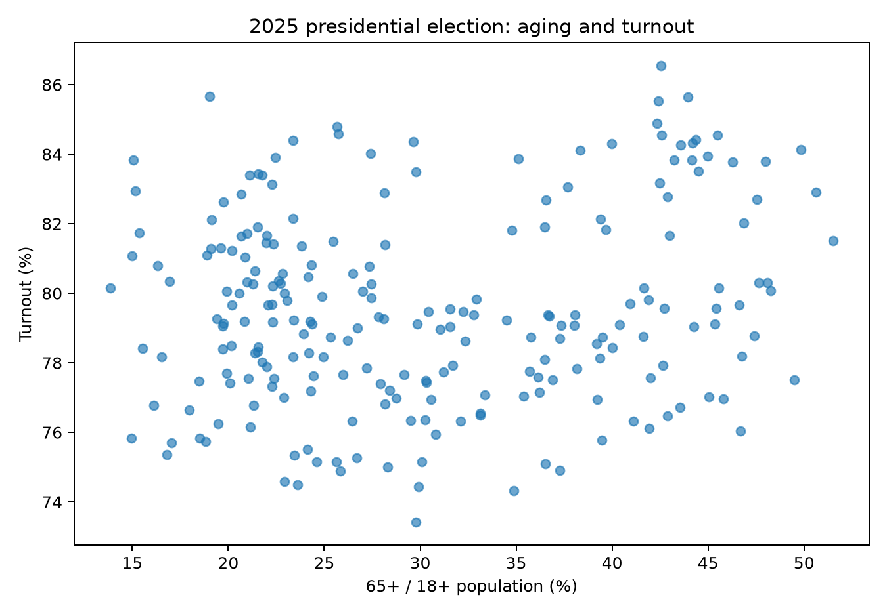
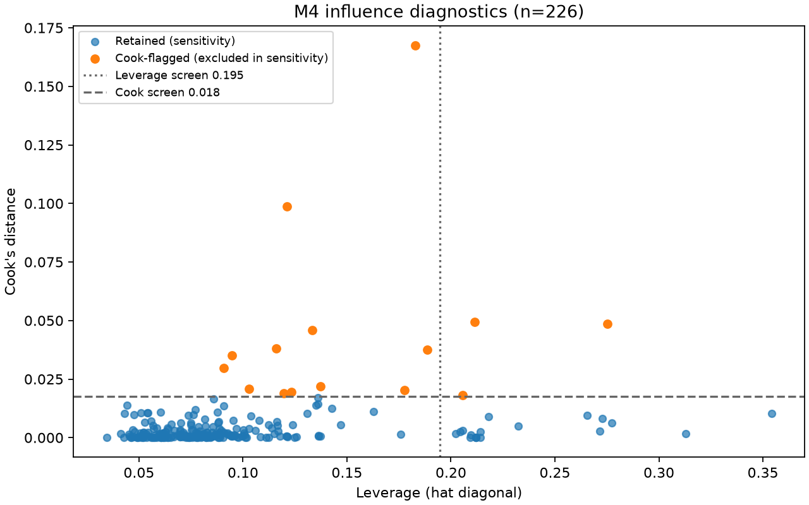
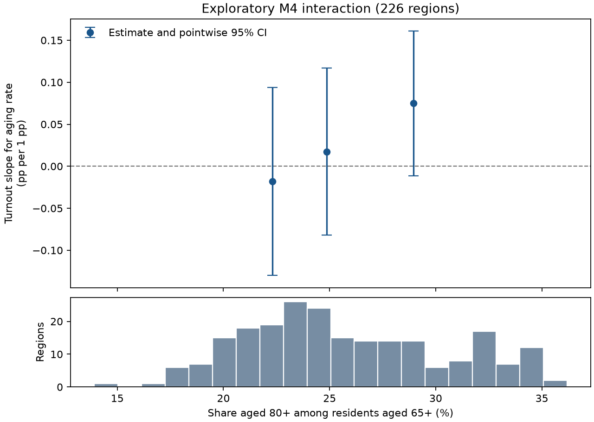

# 지역 고령화와 제21대 대통령선거 투표율

**2025년 6월 3일 선거의 시군구 단위 분석 · 인용·주장 검수본**

## 초록

2025년 제21대 대통령선거에서 성인 중 65세 이상 주민 비율이 높은 지역의 투표율이 높았는지, 고령층 안에서 80세 이상 인구의 비중을 고려하면 관계가 어떻게 달라지는지 분석했다. 공식 개표결과와 주민등록인구, 재정 및 인구이동 자료를 228개 지역으로 결합했다. 지역유형과 시도 효과를 포함한 기본 모형 M4는 세종과 통합 제주를 제외한 226개 지역을 사용했다. 고령화 수준의 계수는 +0.063, 초고령 비중의 계수는 −0.070이었다. 두 계수의 95% 신뢰구간은 모두 0을 포함했다. 단순모형에서는 고령화 수준과 투표율 사이에 양의 관계가 관찰됐으며, 통제변수와 가중치 및 영향점 처리에 따라 추정 결과가 달라졌다. 결과는 한 차례 선거에서 관찰한 지역 간 연관성으로 해석한다.

## 1. 연구질문과 가설

연령에 따른 투표 참여 차이는 한 지역의 연령 구성이 그 지역의 투표율과 관련될 수 있다는 가설을 뒷받침한다. 이신행·서찬석(2024)은 2022년 사회통합실태조사에서 응답자의 세 선거 자기보고 참여를 합산했다. 연령이 높은 응답자일수록 이 지표가 높았다(64쪽, 표 3). 개인의 연령과 투표 참여에 관한 결과에서 지역의 연령 구성과 지역 전체 투표율 사이의 관계가 곧바로 도출되지는 않는다. 지역마다 투표 환경과 정치적 맥락도 다르기 때문이다. [이신행·서찬석, 2024](https://www.kci.go.kr/kciportal/ci/sereArticleSearch/ciSereArtiView.kci?sereArticleSearchBean.artiId=ART003111529)

고령층의 투표 참여도 연령대와 생활 조건에 따라 달라질 수 있다. Engelman 외(2022)는 위스콘신 종단조사 참여자의 건강·자산 자료를 선거인 등록기록의 투표 이력과 연결해 노년기 투표 궤적을 분석했다. Lahtinen과 Martikainen(2024)은 1999년 핀란드 의회선거의 65세 이상 유권자 자료를 사망 추적자료와 연결해 연령과 남은 생애가 투표 참여와 맺는 관계를 분석했다. 이 연구들을 배경으로 고령층의 규모와 내부 연령 구성을 구분하되, 지역의 초고령 비중은 인구 구성 지표로만 사용한다. [Engelman 외, 2022](https://doi.org/10.1093/geronb/gbab191) · [Lahtinen과 Martikainen, 2024](https://researchportal.helsinki.fi/en/publications/time-to-death-explains-the-chronological-decline-of-voter-turnout/)

이 연구는 성인 주민등록인구 중 65세 이상 비율(X1)과 투표율의 연관성, 그리고 X1과 지역 조건을 고려한 뒤 65세 이상 중 80세 이상 비중(X2)과 투표율의 연관성을 살펴본다.

- **H1.** 고령화 수준 X1의 계수는 양수일 것이다.
- **H2.** 고령화 수준과 다른 지역 조건이 같을 때 초고령 비중 X2의 계수는 음수일 것이다.

[연구 프로토콜](PROTOCOL.md)

## 2. 자료와 변수

**표 1. 자료의 시점과 변수 정의**

| 변수 | 조작적 정의 | 출처와 기준 시점 |
|---|---|---|
| 투표율(Y) | 100 × 개표 기준 투표수(유효·무효 포함) / 같은 범위의 선거인수 | 중앙선관위 제21대 대통령선거 개표결과, 2025-06-03 |
| 고령화 수준(X1) | 100 × 65세 이상 주민등록인구 / **18세 이상 주민등록인구** | 행정안전부 연령별 주민등록인구, 2025년 5월 말 |
| 초고령 비중(X2) | 100 × 80세 이상 주민등록인구 / 65세 이상 주민등록인구 | 같은 행정안전부 자료 |
| 재정자립도 | 개편 후 지표, 일반회계 기준의 자치단체 제공값(%) | 지방재정365, 2025년 당초예산 |
| 순이동률 | 100 × 2024년 순이동자수 / 2024년 주민등록연앙인구 | KOSIS 시군구별 이동자수와 주민등록연앙인구, 2024년 연간 |
| 로그 인구 | 2025년 5월 말 주민등록 총인구의 자연로그 | 행정안전부 연령별 주민등록인구 |
| 지역유형·시도 | 시·군·자치구 유형 및 소속 시도의 범주형 변수 | 행정안전부 행정구역 자료와 지역코드 대응표 |

X1의 주민등록 성인인구와 Y의 선거인명부는 모집단이 다르다. 순이동률의 분모는 KOSIS가 제공하는 해당 연도 거주자 기준 연앙인구다. 자료별 모집단과 집계 시점을 유지한 채 지역코드로 결합했다. [공식 자료 출처·조회 조건](SOURCES.md) · [코드북](CODEBOOK.md)

분석 명부는 기초자치단체 226곳에 세종과 통합 제주를 더한 228곳이다. 선거인수·투표수는 선거 원본의 일반구와 분할 집계 구역을 해당 시로 합산했다. 제주는 제주시와 서귀포시를 통합했고, 인구·이동 자료에서 상위 총계가 제공된 경우 해당 값을 사용했다. 재정자립도는 대응하는 자치단체의 제공값을 사용했다. 결합 자료에서 분석 변수의 결측은 0건이었다. M1~M3에는 228곳을 사용하고, M4에는 행정 층위와 고정효과 설계가 다른 세종·제주를 제외한 226곳을 사용했다. [지역 대응 및 제외 근거](CODEBOOK.md) · [자료 인증서](../outputs/data_quality.json) · [모형별 지역 명단](../outputs/tables/model_samples.csv)

### 공식 투표율 대조

전국 선거인수 44,391,871명과 개표 기준 투표수 35,236,497명은 공식 실제투표율 표와 일치했다. 전국 표시 투표율은 79.4%이며, 같은 표의 시도 17개 행에서도 계수와 표시 투표율을 직접 대조했다.

**표 2. 공식 파일별 투표수와 집계 기준**

| 자료 | 전국 투표수 | 사전투표 집계 기준 | 개표 기준과의 차이 | 조정 후 차이 |
| --- | --- | --- | --- | --- |
| 개표결과·공식 실제투표율 | 35,236,497명 | 개표수 | 0명 | 0명 |
| 공식 사전투표 분석표 | 35,237,508명 | 투표용지 교부수 | +1,011명 | 0명 |

공식 사전투표 분석표는 사전투표의 용지 교부수와 나머지 방식의 개표수를 합한다. 공식 파일의 주석(278~280행)에 따라 원본 구역 253곳에서 원래 값·교부수와 개표수 차이·조정 후 잔차를 기록했다. 이를 연구 단위 228곳으로 합산했을 때 조정 후 차이는 모두 0명이었다. 지역별 조정에는 같은 개표자료의 사전투표수를 재사용했다. 별도 공식 표의 개표 기준 수치와 직접 대조한 범위는 전국과 시도다. 연구의 Y에는 개표 기준 투표수를 사용했다. [공식 파일과 주석 기록](SOURCES.md) · [직접 대조 및 지역별 조정표](../outputs/official_reconciliation.csv)

## 3. 분석 방법

지역을 같은 비중으로 두고 기술통계와 피어슨 상관을 산출한 뒤, 설명변수를 순차 추가한 OLS 모형을 추정했다. M1은 X1, M2는 X1과 X2, M3는 두 연령변수에 재정자립도·순이동률·로그 인구, M4는 M3에 지역유형·시도 고정효과를 포함한다. M4의 기준범주는 군과 강원특별자치도다. X1과 X2를 함께 넣은 모형에서는 나머지 설명변수를 일정하게 둔다. X1 계수는 고령층 내부의 연령 구성을 고정했을 때의 연관성이고, X2 계수는 고령층의 상대적 규모를 고정했을 때의 연관성이다.

비율 변수의 계수는 설명변수 1%p 차이에 대응하는 투표율의 %p 차이로 읽는다. 불확실성은 HC3 이분산 강건 표준오차에 기반한 정규근사 양측 95% 신뢰구간과 양측 p값으로 표시한다. 가설별로 계수의 방향과 신뢰구간의 0 포함 여부를 함께 평가한다. 공통표본, 선거인수 가중, 영향점 제외와 상호작용은 기본 모형 결과에 붙여 해석한다. [추정 및 표본 계약](PROTOCOL.md) · [설계와 적합도](../outputs/tables/model_summary.csv)

## 4. 결과

### 4.1 지역별 분포와 단순 상관

**표 3. 주요 변수의 기술통계 (228개 지역)**

| 변수 | 평균 | 표준편차 | 최솟값 | 중앙값 | 최댓값 |
| --- | --- | --- | --- | --- | --- |
| 투표율 (%) | 79.54 | 2.78 | 73.42 | 79.22 | 86.54 |
| 고령화 수준 (%) | 30.33 | 9.74 | 13.85 | 28.14 | 51.51 |
| 초고령 비중 (%) | 25.78 | 4.69 | 13.90 | 24.86 | 36.19 |
| 재정자립도 (%) | 18.91 | 10.76 | 6.08 | 15.79 | 55.71 |
| 순이동률 (%) | -0.07 | 1.48 | -4.34 | -0.36 | 9.17 |
| 로그 인구 | 11.80 | 1.09 | 9.11 | 11.87 | 13.99 |

지역별 투표율을 동일 비중으로 평균한 79.54%와 전국 선거인수를 분모로 한 79.4%는 집계 방식이 다르다. 투표율과 X1의 피어슨 상관은 0.163, 투표율과 X2는 0.277이었다. 두 설명변수 사이의 상관은 0.832로, 한 변수를 고정해 다른 변수와 투표율의 관계를 읽을 때 추정의 불확실성도 함께 봐야 한다. [기술통계 원표](../outputs/tables/descriptive_statistics.csv) · [상관 원표](../outputs/tables/correlation_pairs.csv)

**그림 1.** 각 점은 한 지역이다. 가로축은 18세 이상 주민등록인구 중 65세 이상 비율, 세로축은 개표 기준 투표율이다.

### 4.2 기본 모형과 가설 평가

**표 4. 기본 OLS 모형의 핵심 계수와 적합도**

| 모형 | 지역 수 | X1 β [95% CI] | p(X1) | X2 β [95% CI] | p(X2) | R² |
| --- | --- | --- | --- | --- | --- | --- |
| M1 | 228 | +0.0466 [+0.0090, +0.0841] | 0.015207 | — | — | 0.027 |
| M2 | 228 | -0.0627 [-0.1257, +0.0004] | 0.051412 | +0.2724 [+0.1414, +0.4034] | 0.000046 | 0.092 |
| M3 | 228 | -0.0570 [-0.1553, +0.0414] | 0.256264 | +0.2764 [+0.1424, +0.4103] | 0.000052 | 0.093 |
| M4 | 226 | +0.0628 [-0.0318, +0.1573] | 0.193486 | -0.0701 [-0.1887, +0.0486] | 0.247160 | 0.642 |

괄호 안은 양측 95% 신뢰구간이다. —는 해당 변수가 식에 없음을 표시한다. R²는 해당 모형의 표본 내 적합도를 나타낸다. [전체 회귀계수](../outputs/tables/model_coefficients.csv) · [모형 요약](../outputs/tables/model_summary.csv)

**H1.** M1에서는 X1과 투표율 사이에 양의 관계가 관찰됐다. X2를 고려한 M2·M3에서는 점추정치가 음수로 바뀌었다. M4에서 다시 양수였으나 신뢰구간은 0을 포함했다. 따라서 통제 후 일관된 양의 관계를 지지하는 증거는 확보하지 못했다.

**H2.** M2·M3의 X2 계수는 가설과 반대로 양수였고 신뢰구간도 0보다 높았다. M4에서 점추정치는 음수로 바뀌었으나 신뢰구간이 0을 포함해 가설 방향을 뒷받침하는 근거는 제한적이었다. [모형별 가설 평가 원표](../outputs/tables/hypothesis_evaluation.csv)

## 5. 감도분석과 탐색적 상호작용

### 5.1 공통표본, 가중치 및 영향점

**표 5. 공통표본·가중치·영향점에 따른 핵심 계수**

| 모형 | 지역 수 | X1 β [95% CI] | X2 β [95% CI] |
| --- | --- | --- | --- |
| M1 공통표본 | 226 | +0.0479 [+0.0104, +0.0853] | — |
| M2 공통표본 | 226 | -0.0647 [-0.1274, -0.0021] | +0.2789 [+0.1487, +0.4092] |
| M3 공통표본 | 226 | -0.0551 [-0.1535, +0.0434] | +0.2874 [+0.1552, +0.4195] |
| 기본 M4 | 226 | +0.0628 [-0.0318, +0.1573] | -0.0701 [-0.1887, +0.0486] |
| M4 선거인수 가중 | 226 | +0.1097 [+0.0083, +0.2110] | -0.0556 [-0.2014, +0.0902] |
| M4 Cook 표식 제외 | 211 | +0.0701 [+0.0044, +0.1357] | +0.0046 [-0.0940, +0.1032] |

공통표본에서는 같은 226곳에서 통제 구조를 비교했다. M3과 동일한 식에서 세종·제주를 제외하면 X2 계수는 +0.276에서 +0.287로 변했다. 같은 226곳에 지역유형과 시도 효과를 함께 추가하면 −0.070이 됐다. 이 비교에서 두 지역을 뺄 때보다 통제 구조를 바꿀 때 계수 변화가 컸다. 세종·제주를 포함한 M4는 특수지역 더미와 시도 더미 사이의 선형 종속과 단일 관측 시도로 인해 같은 식의 HC3 비교가 불가능했다. [공통표본·특수지역 비교](../outputs/tables/robustness_comparisons.csv) · [설계 검수](../outputs/robustness_validation.json)

M4와 같은 226곳에 선거인수 가중치를 적용하면 X1 계수는 +0.110으로 커졌고 신뢰구간이 0보다 높았다. 선거인수가 많은 지역에 더 큰 비중을 둔 추정이다. Cook 거리 기준 4/n을 넘은 15곳을 제외하면 X1의 점추정치는 +0.070으로 소폭 바뀌었고 신뢰구간 하한이 0보다 높아졌다. X2는 이 표본에서 +0.005로 부호가 바뀌었으며 신뢰구간은 여전히 0을 포함했다. Cook 거리는 같은 표본의 잔차와 레버리지로 계산한 점검 지표다. 제외 후 신뢰구간은 선택된 부분표본에 대한 감도 지표로 보고한다. 가설 평가는 기본 M4를 기준으로 한다. [Cook 거리 재추정](../outputs/tables/m4_cook_sensitivity.csv) · [제외 지역](../outputs/tables/m4_cook_exclusions.csv)

**그림 2.** 가로축은 레버리지, 세로축은 Cook 거리다. 주황색은 기본 M4에 포함됐고 감도분석에서만 제외된 지역이다.

고정효과를 포함한 설계의 분산팽창계수(VIF)는 X1 8.09, X2 5.90으로 사전에 정한 점검 기준 5를 넘었다. 시도 더미를 포함한 M4에서 시도별 평균 잔차는 수치 오차 범위에서 0이었지만, 시도 내부의 잔차 분산은 남았다. 시도별 평균은 설계의 성질을 반영하며, 잔차 간 공간 상관의 유무를 판별할 수 없다. [공선성 진단](../outputs/tables/m4_vif.csv) · [시도별 잔차](../outputs/tables/m4_province_residuals.csv)

### 5.2 고령화 수준과 초고령 비중의 상호작용

기본 M4와 같은 226곳에서 X1·X2를 각각 표본평균으로 중심화한 뒤 하위 항과 곱 항을 추정했다. 상호작용 계수는 +0.013980(95% CI [+0.005753, +0.022207], p=0.000867)이었다. 이 모형에서는 X2가 1%p 높은 지역에서 X1과 투표율 사이의 기울기가 0.013980만큼 큰 것으로 추정됐다. X1 하위 항과 곱 항의 HC3 공분산을 반영해 조건부 기울기의 점별 신뢰구간을 구했다. [상호작용 계수 원표](../outputs/tables/m4_interaction_coefficients.csv)

**표 6. 초고령 비중의 백분위별 고령화 기울기**

| 평가 지점 | X2 (%) | X1 기울기 [95% CI] | X2 ±1%p 내 지역 수 | 해당 지역의 X1 범위 (%) |
| --- | --- | --- | --- | --- |
| 25백분위 | 22.32 | -0.0181 [-0.1300, +0.0937] | 32 | 15.05–31.21 |
| 50백분위 | 24.86 | +0.0174 [-0.0818, +0.1167] | 38 | 18.53–41.63 |
| 75백분위 | 28.96 | +0.0748 [-0.0112, +0.1608] | 22 | 25.67–48.25 |

평가한 세 지점의 신뢰구간은 모두 0을 포함했다. 마지막 두 열은 X2 평가점 주변에서 함께 관측된 X1의 범위를 보여준다. 이 분포만으로 다른 통제변수까지 같은 조건에서 비교할 수 있는지는 판단할 수 없다. [조건부 기울기 원표](../outputs/tables/m4_interaction_slopes.csv)

**그림 3.** 위는 X1의 조건부 기울기와 점별 95% 신뢰구간, 아래는 226개 지역에서 관측한 X2의 분포다.

## 6. 해석의 한계

- **지역 집계와 개인 행동.** 종속변수는 전체 선거인의 지역 투표율이다. 개인별 연령과 투표 여부를 연결하지 않아, 고령 유권자 개인의 참여율을 지역 회귀계수에서 추론하면 생태학적 오류가 생긴다. X2는 건강 상태, 이동 제약, 투표 접근성의 직접 측정치가 아니다.
- **횡단면과 누락 변수.** 한 시점의 지역 차이를 비교했으며 시도 효과는 시도 안에 남아 있는 정치적 경쟁, 선거 동원, 지역 사회경제 조건을 모두 설명하지 못한다. 계수는 관측 통제변수를 조건으로 한 연관성이다.
- **조기선거의 일반화.** 제21대 대선은 대통령 파면 뒤 치러진 조기선거다. 관측된 지역 간 관계를 정기 대선이나 다른 선거의 관계로 일반화하려면 별도의 자료가 필요하다. [헌법재판소 파면 결정](https://www.ccourt.go.kr/site/kor/ex/bbs/View.do?bcIdx=4253958&cbIdx=1106) · [선거관리위원회 선거일 공지](https://img.nec.go.kr/common/board/Download.do?bcIdx=268737&cbIdx=1090&streFileNm=1e900dd0-23bf-4ef3-947b-e5ecbb4b4fd0.pdf)
- **지역 의존성과 통계적 불확실성.** HC3는 관측별 이분산을 고려한다. 인접 지역의 잔차 상관을 이 표준오차가 반영하지 않으며, 공간의존성을 별도로 추정하지 않았다. 두 연령변수의 상관과 감도분석의 계수 변화도 함께 고려해야 한다.

## 7. 결론

제21대 대통령선거의 단순모형에서는 고령화 수준과 지역 투표율 사이에 양의 연관성이 나타났다. 두 연령 지표와 재정·이동·인구·지역유형·시도를 함께 고려하면 X1의 양의 관계와 X2의 음의 관계를 명확히 뒷받침하는 증거는 부족했다. 가중치와 영향점 처리에 따라 추정치 또는 신뢰구간이 달라졌고, 초고령 비중에 따른 기울기 변화는 탐색적 결과로 남는다. 이 연구의 결론은 해당 선거의 지역 간 연관성에 한정된다.

## 참고문헌

- 이신행·서찬석(2024). 누가 어떻게 정치에 참여하는가? 세대와 교육 수준에 따른 정치 참여 양상의 차이를 중심으로. *조사연구*, 25(3), 55–80. [학회 원문](https://kasr.skyd.co.kr/survey_SR/25_3_3) · [KCI 서지·초록](https://www.kci.go.kr/kciportal/ci/sereArticleSearch/ciSereArtiView.kci?sereArticleSearchBean.artiId=ART003111529)
- Engelman, M., Joo, W.-T., Fletcher, J., & Burden, B. (2022). Health, Wealth, and Voting Trajectories in Later Life. *The Journals of Gerontology: Series B*, 77(4), 827–837. [DOI](https://doi.org/10.1093/geronb/gbab191)
- Lahtinen, H., & Martikainen, P. (2024). Time to death explains the chronological decline of voter turnout among the older population. *Electoral Studies*, 88, 102775. [DOI](https://doi.org/10.1016/j.electstud.2024.102775)
- 중앙선거관리위원회. 제21대 대통령선거 개표결과 및 투표율 분석. [개표결과](https://www.data.go.kr/data/15025528/fileData.do) · [투표율 분석](https://www.data.go.kr/data/15156333/fileData.do)
- 행정안전부·지방재정365·KOSIS의 인구·재정·이동 자료 및 집계 조건은 [공식 자료 출처 대장](SOURCES.md)에 정리했다.

## 부록. 산출물과 재현 범위

| 본문 | 생성 경로 및 원표 |
|---|---|
| 표 1·2, 지역 수·집계 기준·결측 | 공식 원본 표준화 → 결합·대조. [코드북](CODEBOOK.md) · [자료 인증서](../outputs/data_quality.json) · [공식 대조표](../outputs/official_reconciliation.csv) |
| 표 3·그림 1, 상관 | 탐색 모듈. [탐색 manifest](../outputs/exploration_manifest.json) · [탐색 검수](../outputs/exploration_validation.json) |
| 표 4와 가설 판정 | 회귀 모듈과 산술 대조. [모형 manifest](../outputs/model_manifest.json) · [모형 검수](../outputs/model_validation.json) |
| 표 5, 그림 2, VIF·잔차 | 가중·공통표본·영향점 대조. [가중치 검수](../outputs/robustness_validation.json) · [진단 검수](../outputs/diagnostics_validation.json) |
| 표 6·그림 3, 상호작용 | 중심화한 상호작용 모형과 HC3 선형 대비. [상호작용 검수](../outputs/interaction_validation.json) |

분석 코드 기준점은 머지 커밋 `39e4e06021395adb7b2494f456c5e2f09fcb1f1a`이며, 통합 데이터 SHA-256은 `9e3e2087e431245c661dc2714d9377a1a089ebbf0b3e817a8136884202531cd9`다. 원표·그림 링크는 로컬 보관 경로를 가리킨다. 자체 감사에서 같은 로컬 환경의 임시 폴더에 인증서를 새로 발급해 분석을 재실행했다. 다른 환경에서의 검증에는 현재 작업 경로와 인증서의 연결을 보완하고 로컬 참조자료와 실행 절차를 확보하는 작업이 남아 있다. [자체 감사 기록](../outputs/pre_m6_audit.md) · [인용·수치 검수 기록](../outputs/report/m6_review_validation.json)

