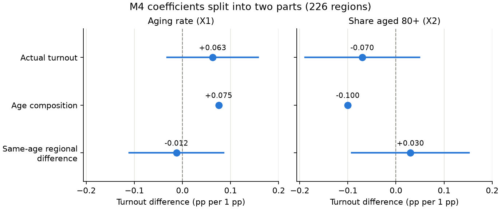
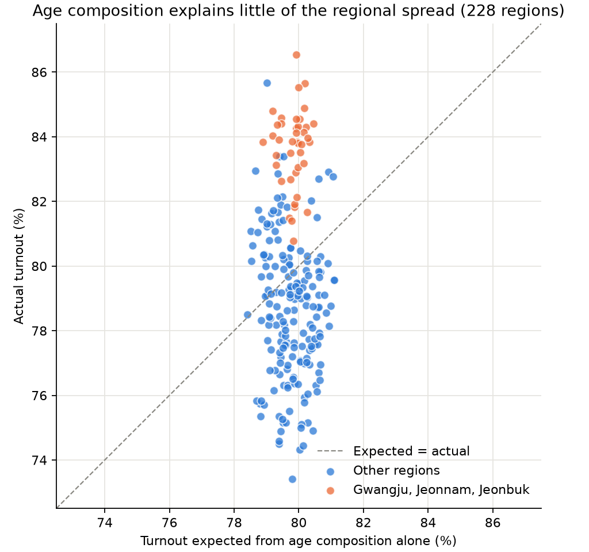

# 나이 구성과 같은 나이대 차이의 분해

**제21대 대통령선거 시군구 분석 · 보충 보고서 · 사전 계획 외 탐색 분석 · 2026-11-10**

이 보고서는 사전 프로토콜에 없던 추가 분석이다. 임시 시범 계산으로 주요 방향을 먼저 본 뒤 [ADR-014](DECISIONS.md)에 규칙을 고정했으므로, 결과를 보기 전에 잠근 설계가 아니다. [최종 보고서](../outputs/report/FINAL_REPORT.md)의 H1·H2 판정은 기본 M4 기준으로 유지하며 이 분석으로 바꾸지 않는다.

## 요약

- 공식 표본 기준으로 228개 지역 모두에서 80세 이상의 투표율이 70대보다 낮았다. 격차의 중앙값은 22.3%p, 범위는 12.2~31.7%p다.
- M4의 계수를 나누면 나이 구성으로 계산되는 몫은 X1 +0.075, X2 −0.100이다. 두 값 모두 가설이 예상한 방향이다. M4의 불확실성은 같은 나이대 안의 지역 차이에서 나온다(X1 −0.012, X2 +0.030, 구간 모두 0 포함).
- 지역 간 투표율 차이는 대부분 나이 구성으로 설명되지 않는다. 표준편차는 실제 2.78%p, 나이 구성 기대값 0.58%p다. 같은 나이대 차이의 약 62%는 소속 시도로 설명된다.
- M3에서 M4로 갈 때 X2의 부호가 바뀌는 현상은 시도 효과, 그중에서도 호남 3개 시도와 관련이 크다. 공선성, 세종·제주, 영향점, 지역유형으로는 부호가 바뀌지 않았다.

## 1. 추가한 이유

기본 M4는 두 가설의 방향을 구분하지 못했다. 시군구 228개는 이미 전수이므로 관측치를 늘려 같은 회귀를 더 정밀하게 만들 수 없다. 공식 ZIP에는 시군구별 연령대 투표율 표가 있으나 기존 분석에서는 쓰지 않았다. 이 표를 이용해 질문을 셋으로 나눴다.

1. 같은 지역 안에서 80세 이상의 투표율이 70대보다 낮은가.
2. 회귀계수 중 나이 구성으로 계산되는 몫과 같은 나이대 안의 지역 차이 몫은 각각 얼마인가.
3. 지역 간 투표율 차이 중 나이 구성으로 설명되는 크기는 얼마인가.

## 2. 자료와 표본 설계

| 자료 | 성격 | 쓰인 곳 |
|---|---|---|
| 실제 투표율 (개표 기준) | 전수 | 주 계산 |
| 2025-05 주민등록 연령별 인구 | 전수 | 주 계산 |
| 전국 연령대 투표율 | 표본 합계 | 주 계산 |
| 시군구별 연령대 선거인·투표자 | 표본 | 보조 지표 (격차, 직접 표준화) |

표본표는 공식 ZIP의 `01_투표율분석결과(표본)/11-성별·연령대별 투표율(구시군별).xlsx`다. 공공데이터포털 설명(2026-11-10 확인)에 따르면 투표구 14,295개 중 1,507개, 선거인 4,506,881명을 체계적 무작위로 추출했고 투표구 30개 미만 단위는 3개를 조사했다. 즉 개인이 아니라 투표구를 뽑은 군집 표본이다. 포털은 지역별 대표성이나 표본 오차를 밝히지 않는다. 연령별 수치가 선거인명부에 근거한다는 것은 모집단 정의에서 추론한 것이다. [공공데이터포털](https://www.data.go.kr/data/15156333/fileData.do)

지역별 표본은 고르지 않다. 추출률은 4.0~44.2%(중앙값 10.3%), 80세 이상 표본 선거인은 최소 197명이다. 표본 합계 투표율과 실제 투표율의 차이는 평균 0.46%p, 최대 2.31%p다. 그래서 분해의 주 계산에는 지역별 표본값을 쓰지 않았다.

## 3. 방법

- `r_a`: 전국 연령대 투표율. 표본 합계 투표자수 / 표본 합계 선거인수이며 공식 전국 표와 같다.
- `C_i` (나이 구성 기대 투표율): 지역 i의 18세 이상 주민등록인구 중 연령대 비중에 `r_a`를 곱해 더한 값. 모든 지역의 연령대별 투표율이 전국과 같다고 가정한 계산값이다.
- `D_i` (같은 나이대 차이): 실제 투표율 `Y_i` − `C_i`.

`Y`, `C`, `D`를 같은 식·표본·HC3 정규근사로 회귀한다. OLS는 종속변수에 선형이므로 `β_Y = β_C + β_D`가 항등으로 성립한다. 실행 때마다 이를 검사하며 최대 차이는 9e-14다. `C` 회귀의 구간은 설명변수가 `C`를 얼마나 선형으로 재현하는지를 나타낼 뿐 통계적 검증이 아니므로 값만 제시한다.

## 4. 결과

### 4.1 같은 지역 안의 격차

228개 지역 모두에서 80세 이상의 투표율이 70대보다 낮았다. 격차가 가장 작은 곳은 부산 중구(−12.2%p), 가장 큰 곳은 인천 중구(−31.7%p)다. 지역별 값은 소수의 투표구에 근거해 오차가 크다. 군집 표본의 오차를 단순무작위 표준오차의 설계효과 1, 2, 4배로 가정해도 228개 지역 모두 구간 상한이 0보다 낮았다. 이 배수는 점검용 가정이며 추정치가 아니다. [지역별 표](../outputs/current/tables/decomposition_regions.csv) · [전국 연령대 투표율](../outputs/current/tables/decomposition_national_rates.csv)

### 4.2 회귀계수의 분해

**표 S1. 226개 지역의 계수 분해** (설명변수 1%p 차이당 투표율 %p 차이)

| 모형 | 부분 | X1 계수 | X2 계수 |
|---|---|---:|---:|
| M1_common | 실제 | +0.0479 [+0.0104, +0.0853] | — |
| M1_common | 나이 구성 | +0.0495 | — |
| M1_common | 같은 나이대 차이 | -0.0017 [-0.0408, +0.0375] | — |
| M2_common | 실제 | -0.0647 [-0.1274, -0.0021] | +0.2789 [+0.1487, +0.4092] |
| M2_common | 나이 구성 | +0.0872 | -0.0933 |
| M2_common | 같은 나이대 차이 | -0.1519 [-0.2154, -0.0885] | +0.3722 [+0.2389, +0.5055] |
| M3_common | 실제 | -0.0551 [-0.1535, +0.0434] | +0.2874 [+0.1552, +0.4195] |
| M3_common | 나이 구성 | +0.0769 | -0.0939 |
| M3_common | 같은 나이대 차이 | -0.1320 [-0.2321, -0.0319] | +0.3813 [+0.2455, +0.5171] |
| M4 | 실제 | +0.0628 [-0.0318, +0.1573] | -0.0701 [-0.1887, +0.0486] |
| M4 | 나이 구성 | +0.0752 | -0.1000 |
| M4 | 같은 나이대 차이 | -0.0125 [-0.1102, +0.0852] | +0.0300 [-0.0919, +0.1518] |
| M4_WLS | 실제 | +0.1097 [+0.0083, +0.2110] | -0.0556 [-0.2014, +0.0902] |
| M4_WLS | 나이 구성 | +0.0795 | -0.0794 |
| M4_WLS | 같은 나이대 차이 | +0.0302 [-0.0737, +0.1341] | +0.0238 [-0.1211, +0.1687] |

나이 구성 몫은 모든 사양에서 X1 양수, X2 음수로 가설 방향과 같다. 실제 계수가 사양마다 달라지는 것은 같은 나이대 차이 몫이 달라지기 때문이다. M2·M3의 X2가 가설과 반대로 나온 것도 이 몫(+0.37~+0.38) 때문이다. [전체 계수](../outputs/current/tables/decomposition_coefficients.csv)

M4의 X2 구간 [−0.189, +0.049]는 0과 나이 구성 몫 −0.100을 모두 포함한다. 표준오차 0.061을 그대로 쓰면, 실제 효과가 −0.100일 때 유의한 결과가 나올 확률은 정규근사로 약 38%다. M4의 결과는 효과가 없다는 뜻이 아니라, 이 크기의 차이를 이 설계로 구분하기 어렵다는 뜻이다.



**그림 S1.** 나이 구성 몫은 계산값이므로 구간을 표시하지 않았다. 나머지 선은 HC3 정규근사 95% 신뢰구간이다.

### 4.3 지역 차이의 크기

228개 지역의 표준편차는 실제 투표율 2.78%p, 나이 구성 기대값 0.58%p, 같은 나이대 차이 2.86%p다. 나이 구성 기대값의 범위는 78.4~81.1%로 실제 범위 73.4~86.5%보다 훨씬 좁고, 둘의 상관은 −0.045다. 같은 나이대 차이의 62.1%는 소속 시도로 설명된다(226개 지역).



**그림 S2.** 각 점은 한 지역이다. 점선 위의 점은 나이 구성으로 계산한 값보다 실제 투표율이 높은 지역이다. 가로 폭이 좁아 나이 구성으로 벌어지는 차이가 작음을 보여준다.

**표 S2. 시도별 투표율** (선거인수 가중, %)

| 시도 | 지역 수 | 실제 | 나이 구성 기대 | 나이 구성 조정 |
|---|---:|---:|---:|---:|
| 광주광역시 | 5 | 83.90 | 79.23 | 84.09 |
| 세종특별자치시 | 1 | 82.94 | 78.65 | 83.72 |
| 전라남도 | 22 | 83.58 | 79.74 | 83.26 |
| 전북특별자치도 | 14 | 82.47 | 79.69 | 82.21 |
| 서울특별시 | 25 | 80.08 | 79.10 | 80.40 |
| 대구광역시 | 9 | 80.18 | 79.63 | 79.98 |
| 울산광역시 | 5 | 80.04 | 79.77 | 79.69 |
| 경기도 | 31 | 79.36 | 79.22 | 79.57 |
| 대전광역시 | 5 | 78.72 | 79.25 | 78.89 |
| 경상북도 | 22 | 78.94 | 79.91 | 78.45 |
| 경상남도 | 18 | 78.53 | 79.84 | 78.12 |
| 부산광역시 | 16 | 78.37 | 79.84 | 77.96 |
| 인천광역시 | 10 | 77.70 | 79.39 | 77.74 |
| 강원특별자치도 | 18 | 77.57 | 79.85 | 77.15 |
| 충청북도 | 11 | 77.26 | 79.59 | 77.10 |
| 충청남도 | 15 | 75.98 | 79.44 | 75.96 |
| 제주특별자치도 | 1 | 74.58 | 79.40 | 74.61 |

나이 구성 조정 = 실제 − (나이 구성 기대 − 전국 나이 구성 기대 79.42)이며 전수 자료만 쓴다. 세종과 제주는 시도 내 단일 지역이다. 지역별 표본을 쓴 직접 표준화 값은 [시도별 표](../outputs/current/tables/decomposition_provinces.csv)에 비교용으로 함께 있다. 이 값은 지역 간 표준편차가 3.31%p로 실제보다 커서 표본 잡음이 섞인 것으로 보인다.

### 4.4 X2의 부호가 바뀐 이유

M3의 X2 양수가 M4에서 음수로 바뀌는 이유를 경쟁 설명별로 비교했다. 호남 관련 두 행은 시범 계산을 본 뒤 추가했다.

**표 S3. 부호 반전의 경쟁 설명 점검**

| 점검한 설명 | 사양 | n | X2 계수 [95% CI] | R² | 판단 |
|---|---|---:|---:|---:|---|
| 기준 | M3_common | 226 | +0.2874 [+0.1552, +0.4195] | 0.099 | — |
| X1과의 공선성 | X1 제외 | 226 | +0.2411 [+0.1336, +0.3487] | 0.094 | 부호 유지, 기각 |
| 세종·제주 제외 | 두 지역 포함 | 228 | +0.2764 [+0.1424, +0.4103] | 0.093 | 부호 유지, 기각 |
| 영향점 | M3의 Cook 4/n 제외 | 211 | +0.2938 [+0.1684, +0.4193] | 0.122 | 부호 유지, 기각 |
| 지역유형 | 지역유형 추가 | 226 | +0.3147 [+0.1863, +0.4431] | 0.123 | 부호 유지, 기각 |
| 호남 3개 시도 | 호남 더미 1개 추가 | 226 | -0.0608 [-0.1743, +0.0527] | 0.512 | 부호 반전 |
| 호남 3개 시도 | 호남 제외 | 185 | -0.0912 [-0.2123, +0.0299] | 0.056 | 부호 반전 |
| 시도 효과 | 시도 더미 추가 | 226 | -0.0635 [-0.1838, +0.0569] | 0.638 | 부호 반전 |
| 지역유형+시도 | M4 | 226 | -0.0701 [-0.1887, +0.0486] | 0.642 | 부호 반전 |

호남 더미 하나만 넣어도 부호가 바뀌고 R²가 0.099에서 0.512로 오른다. 광주·전남·전북은 나이 구성을 조정해도 투표율이 높고, 전남·전북은 80세 이상 비중도 높다. 이 관계가 M2·M3의 양의 계수에 반영된 것으로 보인다. 호남의 투표율이 높은 이유는 이 자료로 알 수 없다. [부호 점검 표](../outputs/current/tables/decomposition_sign_checks.csv)

## 5. 감도분석

| M4 기준 | 나이 구성 X1 | 나이 구성 X2 | 같은 나이대 X1 | 같은 나이대 X2 |
|---|---:|---:|---:|---:|
| 주 계산 | +0.0752 | -0.1000 | -0.0125 | +0.0300 |
| 연령대 투표율을 지역 인구로 가중 | +0.0755 | -0.1001 | -0.0128 | +0.0301 |
| 연령 비중을 표본 선거인 구성으로 계산 | +0.0810 | -0.1073 | -0.0182 | +0.0372 |

세 기준에서 값의 부호와 크기가 비슷하다. [감도 표](../outputs/current/tables/decomposition_sensitivity.csv)

## 6. 해석의 한계

- **사전 계획 외 분석.** 시범 계산을 본 뒤 규칙을 고정했다. 호남 관련 점검은 결과를 보고 추가했다. 가설 판정의 근거로 쓰지 않는다.
- **나이 구성 몫은 계산값.** 모든 지역의 연령대별 투표율이 같다는 가정의 산술이며 인과효과가 아니다.
- **군집 표본.** 지역별 격차와 직접 표준화는 소수의 투표구에 근거한다. 설계효과는 가정값이고 실제 표본 오차는 포털에 공개되어 있지 않다.
- **기준 차이.** 인구 비중은 주민등록, 연령대 투표율은 선거인 기준이다. 60-69세 구간이 X1의 65세 경계를 가로지른다.
- **단일 선거.** 대통령 파면 뒤 치러진 조기선거 한 번의 결과다. 나이 구성 변화가 투표율 변화로 이어지는지는 여러 선거의 비교가 필요하다.
- **측정하지 않은 원인.** 80세 이상의 투표율이 낮은 이유(건강, 이동 등)와 같은 나이대의 시도별 차이가 생기는 이유는 이 자료로 알 수 없다.

## 7. 결론

80세 이상의 투표율이 70대보다 낮다는 사실은 표본 기준으로 모든 지역에서 관찰됐다. 이 차이가 나이 구성을 통해 지역 투표율에 주는 몫은 80세 이상 비중 10%p당 약 1.0%p로 계산된다. 지역 간 투표율 차이의 대부분은 나이 구성이 아니라 같은 나이대 안의 지역 차이이며, 그중 상당 부분이 시도와 관련된다. M4의 불확실성은 이 지역 차이에서 나오므로, 기존 판정인 "통제 후 명확한 증거 부족"은 구분할 정밀도가 부족하다는 뜻으로 읽는 것이 적절하다.

## 8. 재현

```bash
make build
make decompose
make audit-decomposition
```

코드는 [decomposition.py](../src/political_analysis/decomposition.py), 인공 자료 테스트는 [test_decomposition.py](../tests/test_decomposition.py), 별개 코드의 재계산은 [audit_decomposition.py](../scripts/audit_decomposition.py)에 있다. 재계산은 표 270행, 지역 2,052셀, 계수 660셀, 시도 51셀을 상대 1e-8·절대 1e-9 이내로 대조했다. 같은 원본을 다른 코드로 계산한 것이며 독립된 자료에 의한 재현은 아니다. [실행 기록](../outputs/current/decomposition_manifest.json) · [재계산 기록](../outputs/current/decomposition_validation.json)
